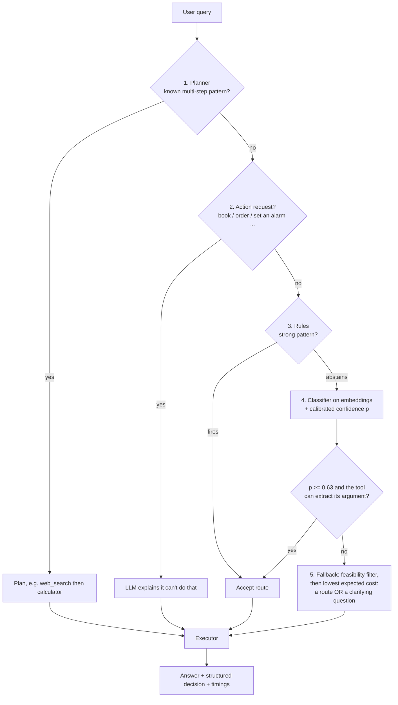
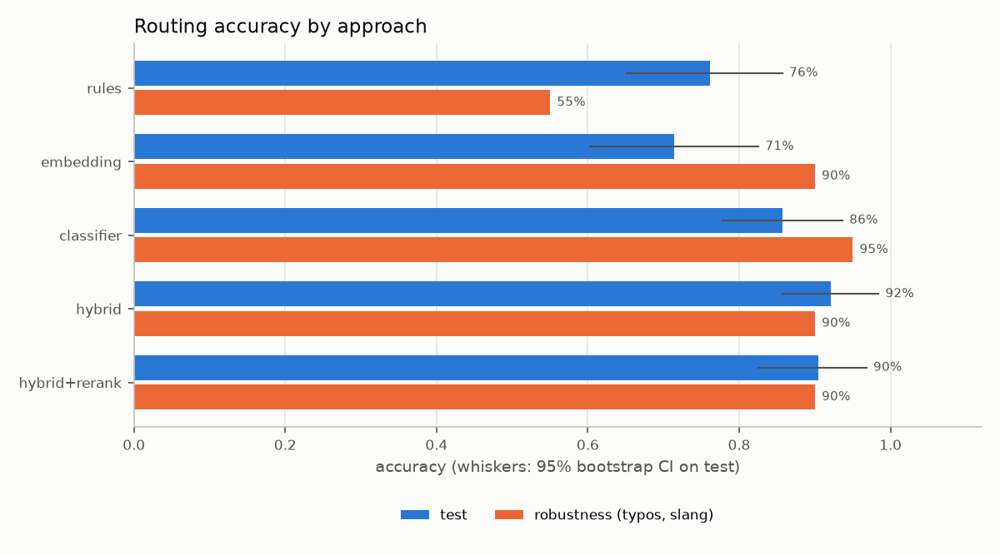
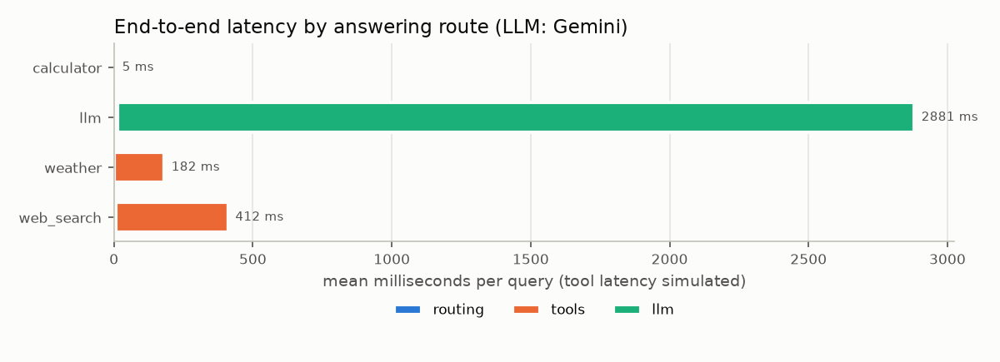

# Intelligent Request Routing Without Native LLM Tool Calling

Problem Statement: decide for every user query whether to answer with LLM or hand it a to a tool (`calculator`, `weather`, `web_search`). 

Routing is done through a cascade from cheap-to-expensive components: high-precision rules, multi-step planner, 
classifer with calibrated confidence, and a cost-based fallback (asks user a clarifying question)

**Results on 63 test-set queries:**

| | Accuracy [95% CI] | Wrong tool chosen | Unnecessary tool calls | Routing latency (p50) |
|---|---|---|---|---|
| Rules only | 76.2% [65.1, 85.7] | 5.6% | 0.0% | 0.0 ms |
| Embedding similarity only | 71.4% [60.3, 82.5] | 8.3% | 56.5% | 6.3 ms |
| Classifier only | 85.7% [77.8, 93.7] | 2.8% | 21.7% | 6.0 ms |
| **Hybrid Model (this system)** | **92.1% [85.7, 98.4]** | **0.0%** | **4.3%** | **6.0 ms** |

---

## Contents
1. [Quick start](#quick-start)
2. [Architecture](#architecture)
3. [How this avoids native tool calling](#how-this-avoids-native-tool-calling)
4. [Design decisions](#design-decisions)
5. [Evaluation methodology](#evaluation-methodology)
6. [Results](#results)
7. [Example outputs](#example-outputs)
8. [Error analysis](#error-analysis)
9. [Latency, accuracy and scalability trade-offs](#latency-accuracy-and-scalability-trade-offs)
10. [Limitations](#limitations)
11. [Possible improvements](#possible-improvements)

---

## Quick start

Requires Python 3.12 (ML libraries lag the newest Python releases).

```bash
python3.12 -m venv .venv && source .venv/bin/activate
pip install -r requirements.txt
cp .env.example .env          # then put your Gemini key in .env (@aistudio.google.com/apikey)
python scripts/list_models.py # checks the key works
```

| What | Command |
|---|---|
| Ask one question | `python -m src.app "What is 245 * 18?"` |
| Interactive mode | `python -m src.app` |
| No Gemini key / offline | add `--mock-llm` |
| Realistic tool latency | add `--simulate-latency` (weather 150 ms, search 400 ms) |
| Enable the reranker | add `--rerank` |
| Full JSON output | add `--json` |
| Unit tests (80) | `pytest -q` |
| Re-fit calibration (validation set) | `python scripts/calibrate.py` |
| Re-tune the threshold (validation set) | `python scripts/tune_thresholds.py` |
| Full evaluation (test set) | `python eval/run_eval.py` (add `--real-llm` for real end-to-end latency) |

Example:

```text
$ python -m src.app --mock-llm "What's 15% of Tesla's stock price?"
{
  "route": "web_search",
  "confidence": 0.9,
  "reason": "Multi-step: look up 'Tesla's stock price', then calculate on the result"
}
stage: planner
plan:  web_search(Tesla's stock price)  ->  calculator(15 / 100 * {0[value]})

answer: 15 / 100 * 981.46 = 147.219   (using: [mock] ... extracted value: 981.46)
```

---

## Architecture



19 of 63 test queries are settled by the rules in about 0.01 ms, and only 6 reach the fallback.

| Stage | File | Role |
|---|---|---|
| Planner | [src/router/planner.py](src/router/planner.py) | two narrow, tested patterns: "maths over a looked-up value" and "weather comparison" |
| Out of scope | [src/router/hybrid.py](src/router/hybrid.py) | Requests for actions no tool can perform go to the LLM, which explains |
| Rules | [src/router/rules.py](src/router/rules.py) | High-precision regexes that **fire or abstain**; weak signals become hints |
| Embeddings | [src/router/embedding.py](src/router/embedding.py) | `all-MiniLM-L6-v2` sentence embeddings of the examples in [routes.yaml](routes.yaml) |
| Classifier | [src/router/classifier.py](src/router/classifier.py) | logistic regression on those embeddings (gives 1 prob per route) |
| Calibration | [src/router/calibration.py](src/router/calibration.py) | maps (top score, margin) to P(correct); fitted on validation |
| Fallback | [src/router/hybrid.py](src/router/hybrid.py) | feasibility filter, then expected-cost minimisation over routes + "clarify" |
| Reranker (optional, off) | [src/router/reranker.py](src/router/reranker.py) | cross-encoder tie-breaker; measured and then disabled |
| Tools | [src/tools/](src/tools/) | AST-safe calculator; mocked weather and web search; rule-based argument extractors |
| Executor | [src/executor.py](src/executor.py) | runs the tool/plan/LLM; default location; execution fallbacks; timings |
| LLM | [src/llm.py](src/llm.py) | gemini, plain text generation only; `MockLLM` for tests |

every router returns the same structured decision ([src/router/decision.py](src/router/decision.py)) 

```json
{"route": "calculator", "confidence": 0.97, "reason": "Contains an arithmetic expression between numbers",
 "stage": "rules", "scores": {}, "hints": ["has_number"], "fallback_used": false, "latency_ms": 0.03,
 "plan": [], "question": null}
```

```
razer/
├── routes.yaml              route definitions + example queries (the training data)
├── config/router.yaml       threshold, cost matrix, default location
├── config/calibration.json  fitted calibrators (regenerate with scripts/calibrate.py)
├── src/router/              decision, rules, embedding, classifier, reranker, calibration, planner, hybrid
├── src/tools/               base, calculator, weather, web_search, extractors, registry
├── src/executor.py  src/llm.py  src/app.py  src/evaluation.py  src/data.py  src/config.py
├── scripts/                 calibrate, tune_thresholds, benchmark_llm, list_models, demo_*.py
├── eval/                    validation.jsonl, test.jsonl, robustness.jsonl, run_eval.py, plots.py, results/
└── tests/                   80 unit tests
```

---

## How this avoids native tool calling

- **Gemini is only called for plain text generation.** [src/llm.py](src/llm.py) never passes `tools`,
  `tool_config` or function declarations. The only call is `generate_content(model, contents, config)`, with a
  system prompt and a temperature.
- **No prompt asks an LLM which tool to use.** The LLM never sees the list of tools. Every routing decision
  comes from rules, embeddings, a logistic-regression classifier and a cost function, all running locally.
- **Arguments are extracted by rules, not by the LLM.** These are the expression, the city and the search
  string ([src/tools/extractors.py](src/tools/extractors.py)).
- **The LLM is used for exactly one thing:** answering queries routed to `llm`, including explaining out-of-scope
  requests and acting as the execution fallback when a tool fails.

---

## Design decisions

all choices made based on **validation set** (48 queries) 

### 1. cheapest first: rules take least time so first in the cascade  
Rules cost about 0.01 ms, the classifier about 6 ms and an LLM call about 1.3 s. 
most obvious cases never pay for expensive ones
additionally the **planner runs before the rules**, because "10% of the *current price* of gold" also triggers the web-search
rule ("current" + "price"), which would drop the calculation step.

### 2. rules: precision over recall
rule either fires (and is almost always right) or **abstains**, leaving the decision to the next stage.

weak signals ("today", a place name) are passed on as hints, not decisions. 
guards encode real distinctions: explanatory questions ("how does rain form?") and climate questions 
("what's the weather *usually* like in Iceland in winter?") never trigger the weather rule. 

### 3. embeddings, then a classifier on top
`all-MiniLM-L6-v2` embeds 97 labelled examples once at startup. 

two ways of using those embeddings were compared on validation:

| Approach | Idea | Validation accuracy |
|---|---|---|
| Nearest neighbours (mean of top-3 cosine similarities per route) | "Which stored examples is this closest to?" | 37/48 |
| Logistic regression (C=10, chosen over C=1 and C=100) | "Which directions in meaning-space point to each route?" | **41/48** |

the classifier learns that *explanation-style* questions belong to the LLM even when they mention weather
words, which nearest-neighbour matching can't do. it is the hybrid's decision-maker.

**Hard examples** in [routes.yaml](routes.yaml) mark the route boundaries. For example, "how cold is outer
space" is labelled `llm`, and "who won the 1998 World Cup" is labelled `llm` (history the model already knows).

### 4. reranker: built, measured, switched off
A cross-encoder reads "query + example" together and re-scores the top-2 routes' closest examples. three models
were compared on validation (embedding alone: 37/48) and then ms-macro-MiniLM-L6-v2 was choosen based on accuracy
and speed. 

inside the hybrid the reranker scored 42/48 on validation vs 43/48 without it, and 90.5% vs 92.1% on test 
(difference not significant), for about 20 ms extra at p95. Its scores also don't indicate when it's right 
(AUROC 0.47). It stays in the codebase behind `use_reranker` / `--rerank`, but is **off by default**.

### 5. calibrated confidence
thresholds on raw scores are meaningless, so a small logistic regression (Platt scaling) maps two features, 
**top score** and **margin over the runner-up**, to P(correct), fitted on validation with 5-fold cross-validation 
for honest numbers. It took three attempts:

| Attempt | Result | Lesson |
|---|---|---|
| Default logistic regression | Every query got about 0.77; ECE looked great | **ECE can be gamed by a constant guess**, so AUROC (does confidence separate right from wrong?) is always reported too |
| No regularisation | Good separation, but outputs of 1.00 | 48 data points can't justify "certain" |
| **Standardised features + default regularisation** | Validation ECE 0.043, AUROC 0.82, max 0.99 | The fix was rescaling the inputs |

On the **test set** (never used for fitting), the classifier's calibrated confidence has ECE **0.027**: when it
says 80%, it is right about 80% of the time ([reliability plot](eval/results/reliability.png)).

### 6. Threshold: a precision target, not "maximise accuracy"
[scripts/tune_thresholds.py](scripts/tune_thresholds.py) sweeps the accept threshold from 0.50 to 0.99 on
validation ([plot](eval/results/threshold_sweep.png)). "Maximise accuracy" picked 0.52, which would skip the
fallback for 96% of queries, because of a **one-query** difference (44 vs 43 of 48), which is noise. The rule
used instead: take the **lowest threshold from which confident decisions are right at least 95% of the time for
every higher threshold too**. That gives **0.63**.

### 7. cost-based fallback
when the router is unsure, it doesn't just pick the most likely route - it picks the action with the **lowest
expected cost**:

> expected_cost(action) = Σ over routes r of P(r is correct) × cost(action, r)

The costs ([config/router.yaml](config/router.yaml)) are **product judgements, written down so they can be
argued with**:

| Mistake | Cost | Reasoning |
|---|---|---|
| Answered a calculation with the LLM | 2 | The arithmetic may be **silently** wrong, so this is the worst outcome |
| Answered a live-data question with the LLM | 1.5 | The system prompt makes the LLM **say** it lacks current data: a disclosed failure, not a hallucination |
| Used the wrong tool | 3 | The answer is useless |
| Used a tool the LLM didn't need | 1 | Slower, but usually still fine |
| Asked a clarifying question | 1.1 | Friction, but never wrong |

### 8. feasibility: argument extraction as a second opinion
if a tool can't extract its argument, it can't be the answer. "How do you calculate compound interest" scores
**94% calculator**, but contains no numbers. a calculation question with no numbers is a *conceptual* maths
question, so the calculator's probability is moved to `llm`.

### 9. clarifying questions only for tool-vs-tool ties
woth these costs, an LLM-vs-tool tie just makes the cheap tool call (asking would annoy the user more). when the
router is at least ~73% sure *some* live tool is needed but can't tell which (1.5 × 0.73 ≈ 1.1), it asks:
*"Just to check: do you want the current weather or the latest information from the web?"* at a clarify cost of
1.2 the system never asked on any query tried, so the value was lowered to 1.1 (validation accuracy unchanged).

### 10. multi-step: narrow patterns instead of a general planner
Python format syntax, e.g. `"15 / 100 * {0[value]}"`:
- maths over a looked-up value: "15% of Tesla's stock price", "half the population of Tokyo"
- weather comparison: "how much warmer is Singapore than London", "is London colder than Paris"

### 11. out of scope: action verbs, not similarity
"Book me a flight to Bali" is 0.62 similar to the weather example "is it nice out in Bali", so similarity can't
detect out-of-scope requests. 
requests that start with an action verb (book, order, send, set, remind...) go to the LLM, whose prompt tells it
to explain what it can't do and suggest alternatives.

### 12. tools
- **the calculator never uses `eval`.** it parses the expression into a syntax tree and evaluates only
  allow-listed nodes (numbers, `+ - * / // % **`, a few named functions). 
  issues found while testing: `9**9**9` (exponent cap), `(10**1000)**1000` (result-size cap), `factorial(400)` 
  (huge-integer formatting) and `1e300*1e300` (non-finite results).
- **safety nets in the executor:** a missing city falls back to a default location; a failing tool falls back to
  the LLM, which is told the lookup failed; division by zero *is* the answer; an LLM outage produces a message,
  not a crash. 

---

## Evaluation methodology

| Split | File | Size | Used for |
|---|---|---|---|
| Training | [routes.yaml](routes.yaml) | 97 examples | Embedding index, classifier |
| Validation | [eval/validation.jsonl](eval/validation.jsonl) | 48 | **Every** design choice: models, C, calibration, costs, threshold |
| Test | [eval/test.jsonl](eval/test.jsonl) | 63 | Reporting only; written before anything ran on it |
| Robustness | [eval/robustness.jsonl](eval/robustness.jsonl) | 20 | Typo/slang variants of test queries |

- **Test categories:** 24 clear, 13 overlapping intents, 10 no-tool, 6 ambiguous, 5 multi-step, 5 out of scope.
- **Ambiguous queries list every acceptable answer** (e.g. "what's it like in Paris": weather, llm or clarify),
  because grading them against a single label would be unfair.
- **Leakage guard:** [eval/run_eval.py](eval/run_eval.py) refuses to run if any test query appears in the
  training examples or the validation set.

**Metric definitions** ([src/evaluation.py](src/evaluation.py)):

| Metric | Definition |
|---|---|
| Accuracy | Predicted route is in the query's acceptable set |
| Strict accuracy | Predicted route equals the single labelled route |
| Incorrect tool selection rate | Of queries that **need** a tool: share sent to a **different** tool |
| Missed tool rate | Of queries that need a tool: share answered by the LLM instead |
| Unnecessary tool-call rate | Of queries where **no** tool is acceptable: share sent to a tool |
| Mean mistake cost | Average cost per query, using the same cost function the router optimises (shared code) |
| Routing latency | Time inside `router.route()`, p50 / p95 |
| End-to-end latency | Routing + tools + LLM, p50 / p95, per answering route |

---

## Results

All numbers are from [eval/results/report.md](eval/results/report.md) (test set, real Gemini run).

### Routing quality

| Router | Accuracy [95% CI] | Incorrect tool | Missed tool | Unnecessary tool | Clarify | Fallback | Mean mistake cost | p50 | p95 |
|---|---|---|---|---|---|---|---|---|---|
| rules | 76.2% [65.1, 85.7] | 5.6% | 30.6% | 0.0% | 0% | 0% | 0.413 | 0.0 ms | 0.0 ms |
| embedding | 71.4% [60.3, 82.5] | 8.3% | 0.0% | 56.5% | 0% | 0% | 0.381 | 6.3 ms | 7.1 ms |
| classifier | 85.7% [77.8, 93.7] | 2.8% | 5.6% | 21.7% | 0% | 0% | 0.198 | 6.0 ms | 6.3 ms |
| **hybrid** | **92.1% [85.7, 98.4]** | **0.0%** | 8.3% | **4.3%** | 0% | 15.9% | **0.111** | 6.0 ms | 7.9 ms |
| hybrid + reranker | 90.5% [82.5, 96.8] | 0.0% | 8.3% | 8.7% | 0% | 15.9% | 0.127 | 6.7 ms | 28.3 ms |



**Each single approach fails in a characteristic way.** Rules never call an unneeded tool but miss 31% of tool
queries. Embeddings never miss a tool but send 57% of no-tool questions to one, fooled by surface similarity.
The current system/cascase avoids both: no wrong-tool selections and half the classifier's mistake cost.

| Paired comparison (test) | Accuracy difference | 95% CI | Beyond luck? |
|---|---|---|---|
| hybrid vs rules | +15.9% | [+4.8, +27.0] | yes |
| hybrid vs embedding | +20.6% | [+9.5, +31.7] | yes |
| hybrid vs classifier | +6.3% | [+1.6, +12.7] | yes |
| hybrid vs hybrid + reranker | +1.6% | [+0.0, +4.8] | no |

### By category and by stage (hybrid)

| Category | rules | embedding | classifier | **hybrid** |
|---|---|---|---|---|
| clear | 83.3% | 100% | 95.8% | 95.8% |
| no tool | 100% | 70.0% | 100% | 100% |
| overlapping intents | 69.2% | 30.8% | 53.8% | **76.9%** |
| ambiguous | 50.0% | 100% | 100% | 100% |
| multi-step | 20.0% | 60.0% | 80.0% | 80.0% (plans fully correct: 80%) |
| out of scope | 100% | 20.0% | 80.0% | **100%** |

| Stage that decided | Queries | Accuracy | p50 routing |
|---|---|---|---|
| classifier | 30 | 90.0% | 6.2 ms |
| rules | 19 | 100% | 0.0 ms |
| fallback | 6 | 66.7% | 6.5 ms |
| planner | 4 | 100% | 0.0 ms |
| out of scope | 4 | 100% | 0.0 ms |

Overlapping intents are the hardest category for every approach, as intended.

### Robustness (typos and slang)

| Router | Test | Robustness | Change |
|---|---|---|---|
| rules | 76.2% | 55.0% | −21.2 |
| embedding | 71.4% | 90.0% | +18.6 |
| classifier | 85.7% | 95.0% | +9.3 |
| hybrid | 92.1% | 90.0% | −2.1 |

Rules collapse on typos ("wether" matches no regex); embeddings read meaning through them. The robustness set
contains mostly *clear* queries, so compare changes *within* a router rather than across rows.

### Calibration on unseen data

| Calibrated confidence of | ECE (lower = more honest) | AUROC (higher = better at flagging its own mistakes) |
|---|---|---|
| embedding router | 0.041 | 0.817 |
| classifier | 0.027 | 0.714 |

### Latency (real Gemini: `gemini-3.5-flash-lite`; tool latency simulated)

| Answered by | Queries | Total p50 | Total p95 | Mean routing | Mean tools | Mean LLM |
|---|---|---|---|---|---|---|
| calculator | 9 | 0.1 ms | 20.3 ms | 4.8 ms | 0.1 ms | – |
| weather | 12 | 155.5 ms | 306.8 ms | 2.1 ms | 180.1 ms | – |
| web_search | 15 | 412.8 ms | 428.8 ms | 7.5 ms | 404.4 ms | – |
| llm | 27 | 1,320.5 ms | 15,496.1 ms* | 14.2 ms | – | 2,867.3 ms* |



\* **The LLM p95 and mean are inflated by the free-tier rate limit, not by Gemini itself.** The run hit 9
rate-limit retries (2 s / 4 s / 8 s back-off), and 2 calls still failed after retrying. Those were answered with
the executor's "couldn't reach the language model" message instead of crashing. Individual Gemini calls in
[examples.md](eval/results/examples.md) took 1.1–1.8 s. Overall end-to-end: p50 415.5 ms, p95 1,758.4 ms.
The route that actually answered was correct for 92.1% of queries.

---

## Example outputs

Full structured outputs (decision, tool results, timings, events) for 11 queries are in
[eval/results/examples.md](eval/results/examples.md). Summary:

| Query | Route (stage) | Answer |
|---|---|---|
| What is 245 * 18? | calculator (rules, 0.97) | `245 * 18 = 4,410` |
| What is the weather in Singapore today? | weather (rules, 0.93) | `[mock] Weather in Singapore: hazy, 14°C, ...` |
| Who won the latest Formula 1 race? | web_search (rules, 0.90) | `[mock] Top results for ...` |
| Explain gradient descent. | llm (classifier, 0.98) | Gemini's explanation (1.8 s) |
| What's 15% of Tesla's stock price? | web_search → calculator (planner) | `15 / 100 * 981.46 = 147.219` (mock price) |
| how much warmer is Singapore than London | weather × 2 → calculator (planner) | `14 - 21 = -7` (mock data) |
| what about tomorrow | clarify (fallback) | "Just to check: do you want the current weather or the latest information from the web?" |
| how do you calculate compound interest | llm (fallback: calculator ruled out) | The compound-interest formula, with an example |
| do I need a coat tonight | weather (classifier, 0.96) | Weather for the default location (Singapore), logged as an event |
| book me a flight to Bali | llm (out of scope) | "I cannot book flights for you... I suggest using Skyscanner, Google Flights..." |
| what is 7 / 0 | calculator (rules) | "I can't compute that: division by zero." |

---

## Error analysis

All misrouted queries, with stage and reason, are in [eval/results/errors.md](eval/results/errors.md).

**Test set (5 of 63):**

| Query | Got | Root cause | Kind of mistake | Proposed fix |
|---|---|---|---|---|
| what are today's top **stories** in tech | llm (classifier, 0.76) | The web-search rule knows "news" but not "stories" | Missed live tool (disclosed) | Broaden the event vocabulary; more news-style examples |
| what's 30 degrees **celsius in fahrenheit** | llm (classifier, 0.71) | The extractor *can* compute it, but feasibility only rules tools **out**, never **in** | Missed calculator | Use successful extraction as positive evidence |
| how much does it **usually** rain in London in November | weather (classifier, 0.97) | The rules' climate guard held, but the classifier never learned "climate" | Unneeded tool | Add climate hard examples to routes.yaml |
| what was Apple's first product | web_search (fallback) | Low confidence; the cost rule prefers a cheap tool call | Unneeded tool (cheap) | Acceptable by design |
| price of gold **divided by** 3 | llm (fallback) | Outside the planner's patterns (deliberately) | Missed multi-step | Add an "X divided by / times N" lookup pattern |

**Robustness set (2 of 20):** "wat is 832 **divded** by 13" and "3 to the **powr** of 7". The classifier
correctly chose the calculator, but the typo broke the extractor, so the feasibility check ruled the calculator
out. The safety net turned extractor brittleness into a routing miss. The LLM still answers these.

---

## Latency, accuracy and scalability trade-offs

**Latency.** Routing costs about 6 ms (p50), under 1% of a single Gemini call (1.1–1.8 s). That is the core
argument for routing without an LLM: an LLM-based router would add a full LLM round-trip to *every* query,
roughly doubling latency for LLM-answered queries and adding far more to tool queries that otherwise finish in
0.1–400 ms. It would also add token cost per query. Inside the router, the cascade puts the cheapest stage first:
30% of test queries are decided by rules in about 0.01 ms. The reranker was rejected partly on latency (about
+20 ms at p95 for no measurable gain). Startup takes about 5 s, to load the model and warm it up, so no user pays
the cold-start cost of the first calls (100–400 ms).

**Accuracy.** The threshold trades **coverage** for **reliability**
([plot](eval/results/threshold_sweep.png)): a higher threshold means fewer confident decisions but fewer
confident mistakes. In the low-confidence zone neither the classifier nor the fallback is reliable, so the
fallback's job is not extra accuracy but **cheaper mistakes**: no silent wrong maths, and a question when two
tools tie. That's why mean mistake cost is reported alongside accuracy.

**Scalability.**
- **New tools** need examples and a tool function, not router code ([see above](#13-adding-a-new-tool-no-router-changes)).
- **Compute:** CPU only, about 90 MB model, about 6 ms per query, one embedding per query regardless of the
  number of routes. The classifier retrains in milliseconds.
- **Many examples:** nearest-neighbour search is a brute-force matrix product, fine up to about 10⁵ examples;
  beyond that, an approximate index (e.g. FAISS) keeps lookup sub-millisecond.
- **Many tools:** the cost matrix and pairwise confusions grow with the number of routes; with dozens of tools,
  hierarchical routing (domain first, then tool) keeps each decision small.
- **Throughput:** queries can be embedded in batches, and repeated queries could use an embedding cache.

---

## Limitations

- **Small evaluation sets.** 63 test queries give wide confidence intervals (±6–11 points). p95 latency over 63
  queries is essentially the third-slowest query: between two runs with no code change, routing p95 moved from
  7.5 ms to 40 ms while the median stayed at 6–7 ms.
- **Tools are mocked.** Weather and search return placeholder data; tool latency is simulated.
- **Narrow multi-step support:** two patterns only; anything else falls back to a single route.
- **The extractors are brittle to typos and unusual phrasing.** A city without "in/for/at" ("Singapore
  weather?") isn't found, and unit conversion covers only temperature and time.
- **The costs are judgements, not measurements.** Different product priorities would justify different costs.
- **No conversation context.** "What about tomorrow?" can't use the previous turn, which is why it triggers a
  clarifying question.

## Possible improvements

1. **Feasibility as positive evidence:** when the calculator extractor matches a strong template (temperature
   conversion), raise the calculator's probability. This fixes the Celsius error.
2. **Data:** climate and news-style hard examples; LLM-generated paraphrases, created *offline* and
   human-reviewed (allowed, since the LLM would not be routing at runtime); a test set written by someone else.
3. **Robust extraction:** fuzzy matching for operator words (e.g. `rapidfuzz`); a named-entity recogniser for
   locations (e.g. spaCy).
4. **Stronger few-shot classifiers:** SetFit (fine-tuning the embedding model on the examples) and a zero-shot
   NLI classifier that routes from tool descriptions alone, so a new tool needs one sentence instead of examples.
5. **Learning from use:** log low-confidence and clarified queries, review them, and add them to routes.yaml
   (active learning).
6. **Conversation context** for follow-ups; real weather/search APIs; FAISS when the example set grows; latency
   reported as the median over several evaluation runs.
